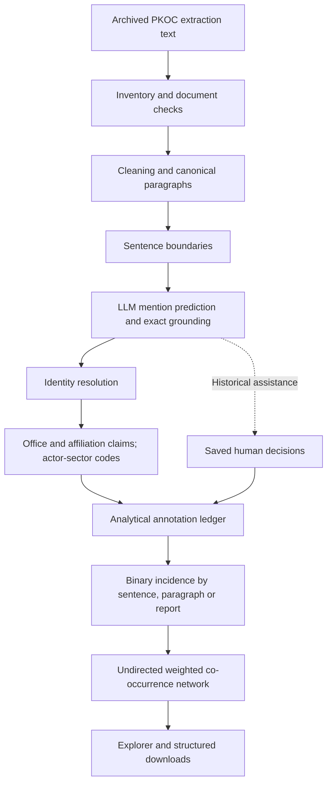

# Research framework and workflow

The UNMIL example examines how annotation and identity decisions affect a political network measured from reports. A source observation, a model prediction, a saved human decision, a coding assumption and a network edge are different objects. Stable identifiers connect these objects without treating them as equally certain.



## Inventory

The [source inventory](../data/source_manifest.csv) identifies 41 included UN documents by symbol, date, official URL and archived-text hash. The excluded map-only corrigendum remains an inventory entry. A filename alone is not sufficient document identification. The source archive is withheld; official links allow readers to find the reports independently.

## Cleaning and boundaries

The historical parser finds the longest document-order chain of numbered paragraphs, removes header/page artifacts and truncates annex content after the final numbered paragraph. Unnumbered text uses a documented blank-line and reflow fallback. UNMIL-specific compatibility rules remain historical study behavior, not general assumptions about every mission.

Normalization applies Unicode NFKC, standardizes apostrophes and dashes, replaces form feeds, collapses whitespace and trims boundaries. Character mappings retain the relationship between raw and canonical offsets. This synthetic example illustrates the rules without reproducing source prose:

```text
Before: "S/2000/999\n12\nAme\u0301lie’s  office—report.\n"
After:  "Amélie's office-report."
```

A fixed sentence splitter protects listed abbreviations, titles and initials and retains trailing fragments. The canonical corpus has 3,075 paragraphs and 12,198 sentence intervals. Hashes and intervals are distributed in the bundle; paragraph text is not. Offsets are zero-based, half-open Unicode codepoints in each canonical paragraph. JavaScript highlighting uses Array.from(text), so supplementary Unicode characters do not shift positions.

Reconstruction from the archived extraction text was verified locally. The historical PDF extractor is unknown: a fresh PDF download is not claimed to regenerate the same extraction bytes.

## Annotation, identity and coding

The original L workflow predicts mentions, grounds literal spans, resolves identities, extracts offices/affiliations and assigns actor-sector codes. Valid empty predictions, failures, ambiguous identities and unavailable offsets remain distinguishable. Matching a literal proves a mechanical span match, not that identity or meaning is correct. Names are not identifiers; similar names and aliases never automatically merge actors.

The frozen L branch has 125 identities and 606 occurrence rows. A has 117 identities and 578 occurrences and incorporates genuine saved human decisions. The public export carries available normalized intervention fields, not private journals or a reconstructed account of every review session. The alias handoff verified 174 saved aliases against the canonical A identities and observations.

R contains 25 occurrences and 15 people in a bounded sample of 120 paragraphs from six reports. It is a dependent same-researcher reference, not an independent gold standard. It has a separate audit view. Its gaps do not establish absence elsewhere in the corpus.

Office and affiliation literals, capacity, role codes, specialty codes, the analytical union and explicit source support remain distinct. Historical report-applicability assumptions are visible. The public glossary provides short original explanations of CAMEO actor-sector identifiers; it does not alter coding assignments. Report dates and year cells describe observations in reports rather than office tenure.

The reusable annotation pipeline is maintained separately. New automated runs produce L-only model outputs, preserve failures and uncertainty and do not inherit A or R. The small UNAMSIL run was a software engineering check, not another study.

## Network construction

For textual unit u and actor a, B[u,a] is one if the actor has at least one eligible occurrence in that unit, otherwise zero. W = BᵀB with the diagonal removed. An edge weight counts distinct shared units. Repeated mentions within one unit count once; all native roster actors remain, including isolates.

Unassigned identities are excluded from projection. Rows without a sentence ID cannot enter sentence incidence; valid paragraph/report identifiers can still support those broader contexts. Each view reports its exclusions. Degree counts neighbors and strength sums edge weights. The [Python projector](../code/explorer_data.py) and independent [JavaScript projector](../web/core.js) expose the calculation.

| Branch | Actors | Sentence edges | Paragraph edges | Report edges |
| --- | ---: | ---: | ---: | ---: |
| L | 125 | 116 | 186 | 929 |
| A | 117 | 128 | 196 | 887 |

Construction controls change reports, years or scale and rebuild the network. Display-only controls change visible marks without changing network exports. Filtered constructions are exploratory. Advanced statistics and communities are saved baseline outputs and are suppressed outside their supported complete-network scope. Edges mean undirected co-occurrence, not interactions or alliances.

## Reproduce and interpret

Use the [public reproduction commands](../README.md#reproduce-the-public-network-views) to validate the supplied annotations and reconstruct all six networks. The [dictionary](data-dictionary.md), [contract](explorer-data-contract.md), [verification](verification.md) and [rights review](publication-review.md) describe the precise limits. Optional compatible local bundles and verified text are read by the browser without upload. Full statistical replay, manuscript building and inference execution remain separate from this static website.
